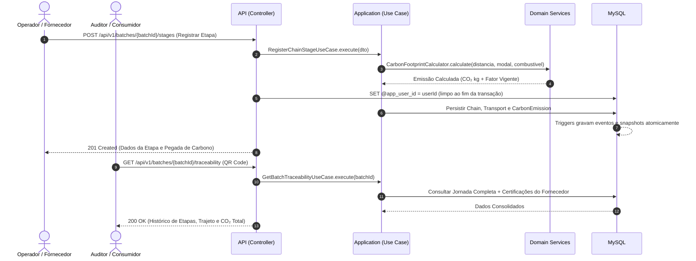
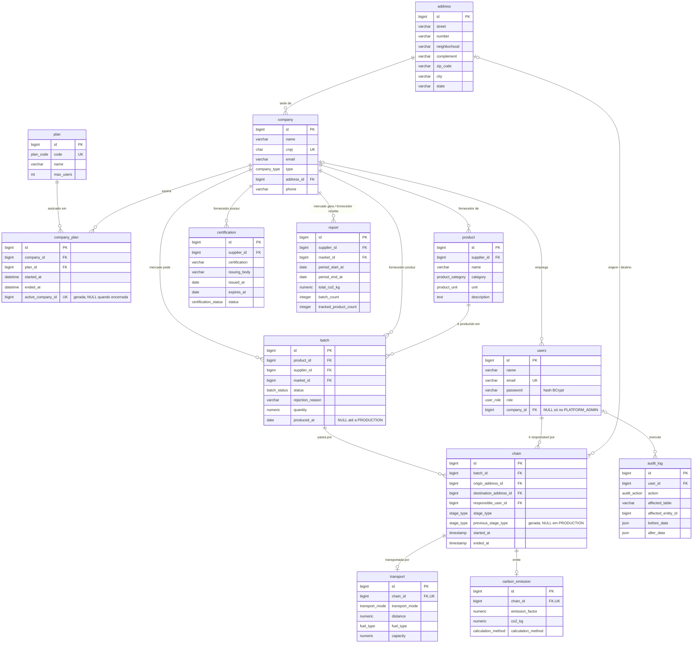

# 🌱 Supply Chain Verde — API de Rastreabilidade & Sustentabilidade


> Rastreabilidade de lotes, mensuração de emissões de CO₂ e auditoria contínua para cadeias de suprimento sustentáveis.

A **Supply Chain Verde API** é uma solução backend de alta confiabilidade desenvolvida em **Java 25** e **Spring Boot**, estruturada sob os pilares da **Clean Architecture** e **Domain-Driven Design (DDD)**. O sistema rastreia cada lote de produto (`Batch`) desde a sua origem primária até o varejo através de etapas logísticas e produtivas (`Chain`), calculando emissões de gases de efeito estufa por transporte/processamento, validando certificações ambientais e gerando relatórios auditáveis com ranking dinâmico de fornecedores.



---

## ✨ O Problema
Cadeias de suprimento modernas enfrentam graves desafios de governança e sustentabilidade:
- **Baixa Rastreabilidade**: Origem fragmentada de insumos e matérias-primas sem histórico contínuo da jornada do produto.
- **Greenwashing & Falta de Auditoria**: Certificações ambientais dispersas em PDFs sem verificação automática de validade ou expiração.
- **Cálculos de Carbono Inconsistentes**: Falta de padronização nas métricas de emissão de CO₂ e inexistência de registro do fator de emissão no momento do transporte.
- **Opacidade para o Consumidor**: Dificuldade do consumidor final em auditar a procedência socioambiental do produto na gôndola.

---

## 🚀 A Solução
A API Supply Chain Verde centraliza e orquestra a cadeia de suprimentos sustentável:
- **Rastreamento Granular por Lote (`Batch`)**: Cada lote é acompanhado através de etapas encadeadas (`Chain`), registrando localizações geográficas, operadores responsáveis e tempos de ciclo.
- **Cálculo de Emissão Confiável**: Emissões calculadas por modais e combustíveis com fixação da metodologia e fator de emissão vigente para auditoria contábil retroativa imutável.
- **Validação de Certificações**: Monitoramento proativo de certificações ativas, vencidas ou suspensas de fornecedores.
- **Ranking Dinâmico de Sustentabilidade**: Cálculo de score sob demanda com base em certificações ativas e histórico de emissões, evitando dados derivados desatualizados no banco.
- **Auditoria Automática**: Triggers MySQL registram alterações nas tabelas de negócio; a API fornece o ator autenticado antes de cada escrita e apenas consulta os eventos.

---

## 🎯 Diferenciais
- **Clean Architecture Pura**: Camada de domínio agnóstica a frameworks e bibliotecas externas.
- **Auditoria mantida pelo banco**: a aplicação não insere linhas de auditoria. Triggers armazenam a operação, entidade afetada e snapshots sanitizados em JSON; consulte a [ADR 0001](docs/adr/0001-auditoria-no-postgresql.md) para o contrato e a [ADR 0002](docs/adr/0002-migracao-para-mysql.md) para como ele é garantido no MySQL.
- **Imutabilidade Histórica de Emissões**: Mudanças em tabelas de referência de emissão não afetam registros históricos passados, garantindo conformidade com normas ESG.
- **Rastreabilidade Pública via QR Code**: Endpoint aberto e otimizado para consulta da árvore genealógica e pegada de carbono do lote.
- **Configuração Sem Arquivos `.env`**: Configuração centralizada em `application.properties` utilizando placeholders flexíveis (`${VAR:default}`), pronta para rodar localmente ou em contêineres sem necessidade de arquivos `.env`.

---

## 🛠️ Stack Tecnológica

| Camada | Tecnologia |
|---|---|
| **Linguagem** | Java 25 (LTS) |
| **Framework** | Spring Boot 4.0.8 (WebMVC, Data JPA, Security, Validation, Actuator) |
| **Banco de Dados** | MySQL 8.4 LTS |
| **Database Migrations** | Flyway (SQL versionado puro) |
| **Mapeamento Objeto-Objeto** | MapStruct 1.6.3 |
| **Segurança & Tokens** | Spring Security + JJWT 0.12.6 (HMAC-SHA256) |
| **Boilerplate Reduction** | Project Lombok |
| **Testes** | JUnit 5, Mockito, Testcontainers (MySQL) |
| **Containerização** | Docker & Docker Compose |

---

## 🏛️ Arquitetura (Clean Architecture)

O projeto segue estritamente a **Regra da Dependência**: classes de camadas externas apontam para dentro; a camada de Domínio desconhece infraestrutura, banco de dados e frameworks.

```
domain          ← Regras de negócio puras, Entidades, Enums, Value Objects e Interfaces de Repositório
   ↑
application     ← Casos de Uso (orquestração), DTOs (records) e Mappers de Aplicação
   ↑
infrastructure  ← Spring Boot, Hibernate/JPA, Controllers REST, Migrations Flyway, Segurança JWT, AOP
```

### Status de Implementação

- **Fase 1 — Domain Layer concluída**: enums, value objects, entidades de domínio, interfaces de repositório, serviços de domínio e exceções estão implementados.
- **Fase 2 — Migrations concluída**: migrations Flyway versionadas para as 11 tabelas do modelo.
- **Fase 3 — Persistence Layer concluída**: entidades JPA, repositórios Spring Data, implementações dos repositórios de domínio e mappers JPA.
- **Fase 4 — Application Layer concluída**: DTOs imutáveis, mappers MapStruct, casos de uso e exceções da aplicação.
- **Fase 5 — Web Layer concluída**: controllers REST, tratamento global de exceções, CORS e documentação OpenAPI/Swagger.
- A camada `domain` permanece sem dependência de Spring/JPA; as integrações concretas ficam nas camadas externas.
- **Fase 6 — Security concluída**: autenticação JWT stateless, hash BCrypt, filtro de autenticação e autorização por perfil.
- **Auditoria — implementação atual**: captura por triggers MySQL na migration V5, com DEFINER próprio e grants por tabela ([ADR 0002](docs/adr/0002-migracao-para-mysql.md)).
- **Views e procedures (A3)**: views de emissão, sustentabilidade e etapa atual; procedures `sp_generate_sustainability_report` e `sp_expire_certifications`, esta agendada por um `EVENT` do MySQL (V3–V4). Ordem obrigatória das etapas garantida por constraints (V1). Consultas de exemplo em [`docs/sql/consultas-relatorio.sql`](docs/sql/consultas-relatorio.sql); desenho em [`docs/features/006-views-procedures`](docs/features/006-views-procedures/spec.md).
- **Fase 8 — Testes concluída**: testes unitários, testes de casos de uso e integração com Testcontainers.
- **Multiempresa (feature 010)**: mercados e fornecedores se cadastram sozinhos com um plano, cada companhia só vê os próprios dados e o mercado pede lotes ao fornecedor (V7–V9). Especificação em [`docs/features/010-empresas-planos`](docs/features/010-empresas-planos/spec.md); integridade por tipo de companhia na [ADR 0003](docs/adr/0003-tipo-de-companhia-por-fk-composta.md).
- Validação local realizada com `./mvnw --batch-mode verify`.

### Principais Entidades de Domínio
- **`Company`**: Companhia `MARKET` (varejista) ou `SUPPLIER` (fornecedor), com CNPJ validado e único, email, telefone e sede em `Address`.
- **`Plan`**: Catálogo de planos (`BASIC` com 3 usuários, `PRO` com 10, `PRO_MAX` com 15). Cada companhia tem uma assinatura ativa por vez.
- **`User`**: Usuário de uma companhia, com perfil compatível com o tipo dela; só o `PLATFORM_ADMIN` não tem companhia.
- **`Certification`**: Certificações ambientais de um fornecedor, gerenciadas por ele, com ciclo de validade.
- **`Product` & `Batch`**: Produto de um fornecedor e o lote que um mercado pede a ele, com status `PENDING`, `ACTIVE` ou `REJECTED`.
- **`Chain`**: Etapas da cadeia (produção, armazenagem, transporte, distribuição, varejo) com `User` responsável obrigatório.
- **`Transport` & `CarbonEmission`**: Dados de frete (modal, combustível, distância) e cálculo de CO₂ emitido.
- **`Report`**: Relatórios de sustentabilidade de um fornecedor, gerados por um mercado com os lotes dele.
- **`AuditLog`**: Registros de auditoria gerados automaticamente para compliance.

### 👥 Perfis e multiempresa

Toda leitura é filtrada pela companhia do usuário logado, e toda escrita fora do escopo dela retorna 403.

| Perfil | Companhia | O que faz |
| :--- | :--- | :--- |
| `PLATFORM_ADMIN` | Nenhuma | Visão global, sem filtro por companhia; herda as permissões de `ADMIN`. Só nasce por migration ou seed |
| `ADMIN` | `MARKET` ou `SUPPLIER` | Gerencia os usuários e os dados da própria companhia; numa companhia fornecedora, também pode tudo o que o `SUPPLIER` pode |
| `MANAGER` | `MARKET` | Pede lotes, registra etapas e gera relatórios |
| `AUDITOR` | `MARKET` | Consulta lotes, relatórios, certificações e auditoria da companhia |
| `SUPPLIER` | `SUPPLIER` | Cadastra os próprios produtos e certificações, recusa lotes ou inicia a produção |

- **Cadastro**: `POST /api/v1/companies` é público e cria companhia, endereço, assinatura e o `ADMIN` numa transação; a resposta já traz o token.
- **Limites**: o número de usuários nunca passa do plano ativo, e toda companhia mantém pelo menos um `ADMIN` (409 nos dois casos).
- **Catálogo**: o mercado vê todos os fornecedores, produtos e certificações para encontrar fornecedores novos. Cada fornecedor traz `workedWith`, que indica se ele tem ou teve lote com o mercado logado.
- **Ciclo do lote**: o mercado pede o lote (`PENDING`) com um produto do fornecedor. O fornecedor recusa com motivo (`REJECTED`, final) ou registra a etapa `PRODUCTION`, que ativa o lote (`ACTIVE`) e preenche `producedAt`.

---

## 🗄️ Banco de Dados

MySQL 8.4 LTS, versionado por migrations Flyway em [`src/main/resources/db/migration`](src/main/resources/db/migration). Grande parte da regra de dados vive no próprio banco: constraints, triggers de auditoria, views de relatório, procedures e o event de expiração. As migrations recomeçam em V1: o histórico PostgreSQL (V1–V39) fica no git ([feature 008](docs/features/008-migracao-mysql/spec.md)).

### Modelo de dados

Todas as tabelas têm `created_at` e `updated_at` (`DATETIME(6)` no horário de São Paulo; `updated_at` com `ON UPDATE CURRENT_TIMESTAMP(6)`), omitidos abaixo.



Integridade por tipo de companhia: as FKs para fornecedor e mercado são compostas com uma coluna gerada constante (`supplier_id, supplier_type → company (id, type)`), então uma companhia do tipo errado não satisfaz a FK. `batch (product_id, supplier_id)` aponta para `product (id, supplier_id)`, garantindo que o produto é do fornecedor do lote. O `UNIQUE` em `company_plan.active_company_id` deixa uma única assinatura ativa por companhia. As colunas `*_type` foram omitidas do diagrama. Veja a [ADR 0003](docs/adr/0003-tipo-de-companhia-por-fk-composta.md).

Integridade da cadeia: `chain` aceita as etapas só na ordem `PRODUCTION → STORAGE → PROCESSING → TRANSPORT → DISTRIBUTION → RETAIL`. A coluna gerada `previous_stage_type` aponta, por uma FK composta para a própria tabela (`fk_chain_previous_stage`), para a etapa anterior do mesmo lote, e `uq_chain_batch_stage` impede repetir etapa. Sem trigger: tudo é declarativo.

Os tipos `company_type`, `plan_code`, `batch_status`, `user_role`, `certification_status`, `product_category`, `product_unit`, `stage_type`, `transport_mode`, `fuel_type`, `calculation_method` e `audit_action` são colunas `ENUM(...)` do MySQL, com os valores dos enums do domínio.

### Views

| View | O que entrega | Quem usa |
|---|---|---|
| `vw_stage_emission` | Uma linha por etapa com emissão: lote, fornecedor, produto, etapa, CO₂, fator e data do cálculo | Base das demais; detalhe do relatório |
| `vw_supplier_product_emission` | CO₂ total, quantidade e CO₂ médio por unidade por fornecedor e produto | Recomendação de fornecedores |
| `vw_monthly_emission` | CO₂ por fornecedor e mês | Gráfico de emissões |
| `vw_supplier_sustainability` | Certificações ativas, CO₂ total e score (`100 + 10 × ativas − CO₂ ÷ 100`, mínimo 0) | Ranking de fornecedores |
| `vw_batch_current_stage` | Etapa mais recente de cada lote | Dashboard (lotes ativos e recentes) |

### Procedures e rotinas

| Objeto | Tipo | O que faz | Quem dispara |
|---|---|---|---|
| `sp_generate_sustainability_report` | Procedure | Grava o relatório como retrato do período: CO₂ total, nº de lotes e nº de produtos | `POST /api/v1/suppliers/{id}/reports` |
| `sp_expire_certifications` | Procedure | Marca como `EXPIRED` as certificações `ACTIVE` vencidas | Event `ev_expire_certifications`, todo dia às 00:00 de São Paulo |
| `audit_write` | Procedure | Parte comum da auditoria: valida o ator e grava em `audit_log` | Triggers `audit_<tabela>_{insert,update,delete}` |

### Event scheduler

O agendamento roda dentro do banco, sem depender da API estar no ar. O `event_scheduler` já vem ligado no MySQL 8.4 e o servidor roda em `America/Sao_Paulo`, então o event dispara à meia-noite local. A migration V4 cria o event.

```sql
SELECT event_name, interval_value, interval_field, starts, last_executed, status
FROM information_schema.events WHERE event_schema = 'supply_chain_verde';
```

Mais consultas prontas para a apresentação em [`docs/sql/consultas-relatorio.sql`](docs/sql/consultas-relatorio.sql).

---

## 📁 Estrutura do Projeto

```text
supply-chain-verde-api/
├── docker/mysql/init/          # Cria supply_app e supply_audit (usado pelo compose e pelo Testcontainers)
├── docker-compose.yml
├── docs/
│   ├── adr/                     # Decisões de arquitetura (ex.: auditoria no banco)
│   ├── features/                # Specs SDD por feature (spec, plan, tasks)
│   └── sql/                     # Consultas de relatório sobre views e procedures
└── src/
    ├── main/
    │   ├── java/…/supplychainverde/   # Código da API (detalhe abaixo)
    │   └── resources/
    │       ├── application.properties
    │       └── db/migration/          # Migrations Flyway: tabelas, seeds, triggers, views e procedures
    └── test/
        ├── java/…/supplychainverde/   # Testes unitários (*Test) e de integração com Testcontainers (*IT)
        └── resources/seed/            # Massa de dados extra para testes
```

```text
src/main/java/br/com/anhembi/supplychainverde/
│
├── domain/                      # Camada de Domínio (Zero dependências externas)
│   ├── entity/                  # Entidades de negócio ricas
│   ├── enums/                   # Enums tipados (StageType, TransportMode, etc.)
│   ├── valueobject/             # Records com validação compacta (Cnpj, EmissionFactor)
│   ├── repository/              # Interfaces puras de persistência
│   ├── service/                 # Serviços de domínio (CarbonFootprintCalculator, PasswordHasher)
│   └── exception/               # Exceções de domínio
│
├── application/                 # Camada de Aplicação (Casos de Uso)
│   ├── usecase/                 # Classes UseCase com método execute()
│   ├── dto/                     # Records imutáveis de Request e Response
│   ├── mapper/                  # Mappers MapStruct (DTO ↔ Domínio)
│   ├── pagination/              # Cálculo de páginas
│   └── exception/               # Exceções da aplicação
│
├── infrastructure/              # Camada de Infraestrutura (Frameworks & Drivers)
│   ├── web/                     # Controllers REST, ExceptionHandler e configs (CORS, Swagger)
│   ├── persistence/             # JPA Entities, Repositories Spring Data e Mappers JPA
│   ├── security/                # JWT Provider, Filtro, BCrypt e SecurityConfig
│   └── audit/                   # Propaga o usuário autenticado para as triggers de auditoria
│
└── SupplyChainVerdeApplication.java
```

## 📚 Documentação do Projeto

| Documento | Conteúdo |
|---|---|
| [`docs/features/000-base/spec.md`](docs/features/000-base/spec.md) | Requisitos funcionais, perfis, regras de negócio e fluxos |
| [`docs/features/000-base/plan.md`](docs/features/000-base/plan.md) | Arquitetura técnica, stack, persistência, segurança e testes |
| [`docs/features/000-base/reference.md`](docs/features/000-base/reference.md) | Entidades, casos de uso, endpoints, DTOs e configuração |
| [`docs/features/000-base/tasks.md`](docs/features/000-base/tasks.md) | Checklist de implementação e evolução |
| [`.github/copilot-instructions.md`](.github/copilot-instructions.md) | Instruções gerais para o GitHub Copilot |

### Pipeline de Qualidade

Os Pull Requests executam automaticamente:

- build e testes Maven;
- geração de cobertura JaCoCo, publicada como artifact;
- revisão de dependências pelo Dependency Review;
- análise estática de segurança com CodeQL.

O CodeQL usa Java 25 explicitamente e não exige token externo. O Dependency Review depende do Dependency Graph habilitado nas configurações de segurança do repositório.

---

## ⚡ Quick Start (com Docker Compose)

### Pré-requisitos
- [Docker & Docker Compose](https://www.docker.com/) instalado
- [JDK 25](https://jdk.java.net/25/) instalado (ou utilize o wrapper Maven incluso)

### 1. Clonar o repositório
```bash
git clone https://github.com/matheusnascimentods/supply-chain-verde-api.git
cd supply-chain-verde-api
```

### 2. Subir o Banco de Dados MySQL
O projeto disponibiliza um `docker-compose.yml` pré-configurado:
```bash
docker compose up -d
```
Isso iniciará o MySQL 8.4 na porta `3306` com o banco `supply_chain_verde`, em `America/Sao_Paulo` e collation `utf8mb4_0900_as_cs`. Na criação do volume, [`docker/mysql/init`](docker/mysql/init) cria os usuários `supply_app` (datasource da API) e `supply_audit` (DEFINER das triggers, sem login). O Flyway roda como `root`. Os testes com Testcontainers usam a mesma imagem, flags e init.

O MySQL faz commit implícito a cada DDL: uma migration que falhe no meio deixa o schema pela metade. Em desenvolvimento, recrie o volume com `docker compose down -v`. Quem vinha do PostgreSQL também precisa recriar o banco do zero: não há cópia de dados.

### 3. Executar a Aplicação
```bash
./mvnw spring-boot:run
```

A API estará disponível em: **`http://localhost:8080`**

A documentação interativa OpenAPI/Swagger fica disponível em:

- **`http://localhost:8080/swagger-ui.html`**
- **`http://localhost:8080/v3/api-docs`**

### Usuários Seed

As migrations de seed criam usuários para desenvolvimento e demonstração. A senha de todos os usuários seed é:

```text
rolocompressor06
```

Depois da V10, o seed fica assim:

- **`PLATFORM_ADMIN`**: `m.neuer@bayern.com`, sem companhia.
- **Mercados** (plano `PRO`, 8 usuários cada). Cada um tem os lotes e relatórios de um terço dos fornecedores do seed, divididos pelo resto de `supplier_id` por 3:

| Mercado | Fornecedores (`supplier_id`) | `ADMIN` | Demais usuários |
| :--- | :--- | :--- | :--- |
| Mercado Bom Preço | múltiplos de 3 | `h.kane@bayern.com` | `j.tah`, `j.kimmich` (`MANAGER`), `j.stanisic`, `a.davies` (`AUDITOR`) e `v.vandijk@liverpool.example.com` (`MANAGER`), `d.rice` e `m.odegaard@arsenal.example.com` (`AUDITOR`) |
| Supermercado Vale Verde | resto 1 | `warren.zaire-emery@psg.example.com` | `j.musiala`, `ousmane.dembele` (`MANAGER`), `m.olise`, `desire.doue` (`AUDITOR`) e `m.caicedo@chelsea.example.com` (`MANAGER`), `r.lavia` e `c.palmer@chelsea.example.com` (`AUDITOR`) |
| Rede Feira Viva | resto 2 | `matvey.safonov@psg.example.com` | `fabian.ruiz`, `nuno.mendes` (`MANAGER`), `joao.neves`, `marquinhos` (`AUDITOR`) e `b.fernandes@manutd.example.com` (`MANAGER`), `m.cunha` e `b.mbeumo@manutd.example.com` (`AUDITOR`) |

- **Fornecedores** (plano `BASIC`): todos os 41 têm um `ADMIN`. Os seis que já tinham usuário mantêm o antigo `SUPPLIER`, promovido na V8 (por exemplo, `d.upamecano@bayern.com` no fornecedor 3). Os outros 35 recebem, em ordem de id, um jogador da V10 (`alisson@liverpool.example.com` no fornecedor 1, `m.kerkez@liverpool.example.com` no 2, e assim por diante).
- O Mercado Verde Demonstração, criado na V8, continua existindo, mas sem usuários, lotes nem relatórios.

Essa credencial é exclusiva para o ambiente local/demonstrativo e deve ser substituída antes de qualquer uso em ambiente compartilhado ou de produção.

O seed ampliado de demonstração é carregado pelas migrations padrão em `src/main/resources/db/migration`.

---

## 💻 Comandos Úteis de Desenvolvimento

```bash
# Compilar o projeto e processar anotações (Lombok + MapStruct)
./mvnw clean compile

# Rodar os testes unitários (*Test)
./mvnw test

# Rodar também os testes de integração com Testcontainers (*IT); exige Docker
./mvnw test -Dtest='*IT,*Test,*Tests'

# Empacotar artefato JAR final
./mvnw clean package

# Parar o banco de dados Docker
docker compose down

# Parar o banco de dados Docker removendo volumes de dados
docker compose down -v
```

---

## 🔌 API Reference (Principais Recursos)

Todas as rotas abaixo respeitam o escopo da companhia do usuário (veja [Perfis e multiempresa](#-perfis-e-multiempresa)). A referência completa, com as rotas removidas na feature 010, fica em [`docs/features/000-base/reference.md`](docs/features/000-base/reference.md).

### 📊 Dashboard (`/api/v1/dashboard`)
| Método | Rota | Descrição | Acesso |
| :--- | :--- | :--- | :--- |
| `GET` | `/api/v1/dashboard/summary?limit=10` | Indicadores e lotes recentes da companhia (`limit` padrão 10, máximo 100) | Qualquer usuário autenticado |
| `GET` | `/api/v1/dashboard/emissions?from=2026-01&to=2026-06` | CO₂ mês a mês da companhia, com zero nos meses sem emissão (máximo 24 meses) | Qualquer usuário autenticado |

`activeBatches` exclui lotes sem etapas e lotes cuja etapa mais recente seja `RETAIL`; a etapa mais recente é determinada por `startedAt`, com `chainId` como desempate. A lista `recentBatches` é ordenada por data de produção decrescente e inclui o status da etapa mais recente. `expiringCertifications` considera vencimentos de hoje até os próximos 30 dias, inclusive. Para o mercado, `suppliers` conta os fornecedores com quem ele tem ou teve lote e `pendingBatches` vem nulo; para a companhia fornecedora, `pendingBatches` conta os lotes `PENDING` dela e `suppliers` vem nulo. `monthlyEmissionKgCo2e` soma o `co2Kg` calculado no mês calendário atual.

### 🔐 Autenticação (`/api/v1/auth`)
| Método | Rota | Descrição | Acesso |
| :--- | :--- | :--- | :--- |
| `POST` | `/api/v1/auth/login` | Autenticação e emissão do token JWT; a resposta traz `role`, `companyId`, `companyType`, `companyName` e `supplierId` | Público |

### 🏢 Companhias & Planos (`/api/v1/companies`, `/api/v1/plans`)
| Método | Rota | Descrição | Acesso |
| :--- | :--- | :--- | :--- |
| `GET` | `/api/v1/plans` | Catálogo de planos com `code`, `name` e `maxUsers` | **Público** |
| `POST` | `/api/v1/companies` | Cadastro de mercado ou fornecedor com plano e administrador; resposta igual à do login. CNPJ ou email repetido → 409; plano inexistente → 400 | **Público** |
| `GET` | `/api/v1/companies/me` | Dados da companhia, endereço e plano ativo | Usuário com companhia |
| `PATCH` | `/api/v1/companies/me` | Altera razão social, email, telefone e endereço (CNPJ e tipo não mudam) | `ADMIN` |

### 👤 Usuários (`/api/v1/users`)
| Método | Rota | Descrição | Acesso |
| :--- | :--- | :--- | :--- |
| `POST` | `/api/v1/users` | Cria usuário na companhia de quem cria, com perfil permitido para o tipo dela; limite do plano → 409 | `ADMIN` |
| `GET` | `/api/v1/users?email={trecho}&limit=20&offset=0` | Usuários da própria companhia; o `PLATFORM_ADMIN` vê todos | Autenticado |
| `GET`/`PATCH` | `/api/v1/users/me` | Dados do usuário logado, com a companhia; o `PATCH` altera nome e senha | Autenticado |
| `PATCH` | `/api/v1/users/{userId}/role` | Troca de perfil na própria companhia; deixar a companhia sem `ADMIN` → 409 | `ADMIN` |

### 🏭 Fornecedores (`/api/v1/suppliers`)
| Método | Rota | Descrição | Acesso |
| :--- | :--- | :--- | :--- |
| `GET` | `/api/v1/suppliers?workedWith=true` | Catálogo de fornecedores com `workedWith`; o filtro restringe aos que têm ou tiveram lote com o mercado | Mercado |
| `GET` | `/api/v1/suppliers?ranked=true&limit=20&offset=0&search={termo}` | Ranking paginado por sustentabilidade; busca por nome (FULLTEXT: todas as palavras, por prefixo) ou trecho do CNPJ | Mercado |
| `GET` | `/api/v1/suppliers?ranked=true&category=AGRICULTURE&unit=KG` | Recomendação pelo menor CO₂ por unidade na categoria e unidade | Mercado |
| `GET` | `/api/v1/suppliers?supplierId={id}` | Detalhe do fornecedor | Mercado; a companhia fornecedora só o próprio |

### 🛒 Produtos (`/api/v1/products`)
| Método | Rota | Descrição | Acesso |
| :--- | :--- | :--- | :--- |
| `POST` | `/api/v1/products` | Cadastro de produto no fornecedor do usuário | `SUPPLIER`, `ADMIN` de fornecedor |
| `PUT` | `/api/v1/products/{productId}` | Atualização do próprio produto | `SUPPLIER`, `ADMIN` de fornecedor |
| `GET` | `/api/v1/products?limit=20&offset=0&search={termo}&supplierId={id}` | Listagem paginada; busca FULLTEXT por nome/descrição ou por categoria. O mercado vê o catálogo e filtra por fornecedor; o fornecedor vê só os próprios | Autenticado |

### 📜 Certificações (`/api/v1/certifications`)
| Método | Rota | Descrição | Acesso |
| :--- | :--- | :--- | :--- |
| `POST` | `/api/v1/suppliers/{supplierId}/certifications` | Registro de certificação ambiental do próprio fornecedor | `SUPPLIER`, `ADMIN` de fornecedor |
| `PATCH` | `/api/v1/certifications/{certificationId}/status` | Atualização do status de uma certificação própria | `SUPPLIER`, `ADMIN` de fornecedor |
| `GET` | `/api/v1/certifications?page=0&size=20&status=ACTIVE` | Listagem paginada; `status` opcional (`ACTIVE`, `EXPIRED`, `SUSPENDED`, `UNDER_REVIEW`). O fornecedor vê só as próprias | `AUDITOR`, `MANAGER`, `ADMIN`, `SUPPLIER` |

### 🧾 Auditoria (`/api/v1/audit-logs`)
| Método | Rota | Descrição | Acesso |
| :--- | :--- | :--- | :--- |
| `GET` | `/api/v1/audit-logs?from=2026-09-01&to=2026-09-30&action=UPDATE&userEmail=ana&limit=20&offset=0` | Logs do período inclusivo feitos pelos usuários da própria companhia, com filtros opcionais e paginação | `ADMIN`, `AUDITOR` |

O período `from`/`to` é obrigatório e usa `YYYY-MM-DD`; `action` aceita `INSERT`, `UPDATE`, `DELETE` ou `STATUS_CHANGE`. `userEmail` faz busca parcial sem diferenciar caixa. `limit` aceita de 1 a 100 (padrão 20) e `offset` começa em 0.

Cada item retornado inclui `logId`, `userId`, `userEmail`, `action`, `affectedTable`, `affectedEntityId`, `beforeData`, `afterData` e `performedAt`. `beforeData`/`afterData` são snapshots JSON com apenas valores alterados e associações como IDs; podem ser `null` quando a operação não tem aquele lado (INSERT/DELETE). Segredos não podem ser incluídos nos snapshots.

A captura é responsabilidade do banco, não de um interceptor Java. Triggers escrevem eventos na mesma transação que altera a linha. Antes de cada escrita auditada, a API executa `SET @app_user_id = :userId` na conexão da transação e limpa a variável no fim dela, para o ator não vazar para a próxima requisição que reaproveite a conexão do pool. As triggers rodam como `supply_audit` e são as únicas que inserem em `audit_log`; o usuário da API só lê. Veja a [ADR 0002](docs/adr/0002-migracao-para-mysql.md).

### 📦 Lotes & Rastreabilidade (`/api/v1/batches`)
| Método | Rota | Descrição | Acesso |
| :--- | :--- | :--- | :--- |
| `POST` | `/api/v1/batches` | Pedido de lote com `productId`, `supplierId` e `quantity`; o produto precisa ser do fornecedor (400). Nasce `PENDING` | `MANAGER`, `ADMIN` de mercado |
| `PATCH` | `/api/v1/batches/{batchId}/reject` | Recusa com `reason` obrigatório; fora de `PENDING` → 409 | Fornecedor do lote |
| `GET` | `/api/v1/batches?page=0&size=20&supplierId=4&status=PENDING` | Lotes do mercado ou do fornecedor, paginados (`page` zero-based; `size` padrão 20, máximo 100), com etapa atual e timeline | `ADMIN`, `MANAGER`, `AUDITOR`, `SUPPLIER` |
| `GET` | `/api/v1/batches/{batchId}/traceability` | Jornada completa do lote (QR Code) | **Público** |

Cada item da página traz `batchId`, `productId`, `productName`, `supplierId`, `supplierName`, `marketId`, `marketName`, `status`, `rejectionReason`, `quantity` e `producedAt` (nulo enquanto `PENDING`), além de `currentStage` (`StageType` da etapa mais recente ou `null`) e `stages` (array cronológico, vazio quando não há etapas). Cada etapa segue o contrato de `ChainResponseDTO`, com `originAddress`, `destinationAddress`, `transport` e `emission` anuláveis. O enriquecimento busca os dados relacionados em lote após a paginação, sem uma consulta por lote.

### 🔗 Etapas da Cadeia (`/api/v1/batches/{batchId}/stages`)
| Método | Rota | Descrição | Acesso |
| :--- | :--- | :--- | :--- |
| `POST` | `/api/v1/batches/{batchId}/stages` | Próxima etapa do lote (ordem obrigatória; fora de ordem → 400). Em `PENDING`, só o fornecedor registra `PRODUCTION`, que ativa o lote; em `REJECTED` → 409. O usuário do header `X-Responsible-User-Id` precisa ser do mercado ou do fornecedor do lote | `SUPPLIER`, `MANAGER`, `ADMIN` do lote |
| `GET` | `/api/v1/batches/{batchId}/stages` | Etapas percorridas pelo lote em ordem | Autenticado |
| `POST` | `/api/v1/stages/{chainId}/transport` | Registro do transporte da etapa | `SUPPLIER`, `MANAGER`, `ADMIN` do lote |

### 🌿 Emissões de Carbono
| Método | Rota | Descrição | Acesso |
| :--- | :--- | :--- | :--- |
| `POST` | `/api/v1/stages/{chainId}/emission` | Cálculo e persistência de emissão de CO₂ | `MANAGER`, `ADMIN` do lote |
| `GET` | `/api/v1/batches/{batchId}/carbon-footprint` | Pegada de carbono consolidada do lote | **Público** |

### 📊 Relatórios ESG (`/api/v1/reports`)
| Método | Rota | Descrição | Acesso |
| :--- | :--- | :--- | :--- |
| `POST` | `/api/v1/suppliers/{supplierId}/reports` | Geração de relatório com os lotes do mercado logado com o fornecedor | `AUDITOR`, `MANAGER`, `ADMIN` de mercado |
| `GET` | `/api/v1/reports?limit=20&offset=0&supplierId={id}` | Relatórios do mercado ou sobre o fornecedor, paginados | `AUDITOR`, `MANAGER`, `ADMIN`, `SUPPLIER` |
| `GET` | `/api/v1/reports?reportId={id}` | Detalhe para o PDF; relatório de outra companhia → 403 | `AUDITOR`, `MANAGER`, `ADMIN`, `SUPPLIER` |

---

## 🗂️ Variáveis de Ambiente & Configuração

O projeto dispensa arquivos `.env` versionados. As configurações são centralizadas em [`application.properties`](src/main/resources/application.properties) e podem ser customizadas via variáveis de ambiente:

| Variável de Ambiente | Descrição | Valor Default (Local) |
| :--- | :--- | :--- |
| `SERVER_PORT` | Porta de execução da API | `8080` |
| `SPRING_DATASOURCE_URL` | URL JDBC do MySQL | `jdbc:mysql://localhost:3306/supply_chain_verde?connectionTimeZone=SERVER` |
| `SPRING_DATASOURCE_USERNAME` | Usuário da API no banco; também recebe os grants da V6 | `supply_app` |
| `SPRING_DATASOURCE_PASSWORD` | Senha do banco de dados | Configurar localmente; nunca usar default em ambientes compartilhados |
| `FLYWAY_ENABLED` | Execução automática de migrations Flyway | `true` |
| `FLYWAY_USER` / `FLYWAY_PASSWORD` | Admin que aplica as migrations (cria triggers com outro DEFINER e dá grants) | `root` / `root` |
| `JWT_SECRET` | Chave HMAC de 256 bits para assinatura do token | Configurar localmente; obrigatório e forte em ambientes compartilhados |
| `JWT_EXPIRATION_MS` | Tempo de expiração do token em milissegundos | `3600000` (1 hora) |
| `CORS_ALLOWED_ORIGINS` | Origem permitida para o frontend cliente | `http://localhost:4200` |

---

Em desenvolvimento local, defina `SPRING_DATASOURCE_PASSWORD` e `JWT_SECRET` no ambiente da execução quando necessário. Em ambientes compartilhados ou de produção, esses valores devem ser obrigatoriamente fornecidos por secrets da plataforma e nunca devem ser credenciais previsíveis ou versionadas.

## 🔒 Segurança & Boas Práticas

- **Autenticação Stateless**: Tokens JWT assinados com HMAC-SHA256, transportando `userId`, `email`, `role`, `companyId`, `companyType` e `supplierId`. Um token sem `companyId` só autentica para o `PLATFORM_ADMIN`.
- **Controle de Acesso Baseado em Perfis (RBAC)**: Papéis `PLATFORM_ADMIN`, `ADMIN`, `MANAGER`, `AUDITOR` e `SUPPLIER`, com `ROLE_PLATFORM_ADMIN > ROLE_ADMIN` na `RoleHierarchy`.
- **Isolamento por companhia**: Listagens filtradas pela companhia do token e escritas fora do escopo recusadas com 403. O tipo da companhia em cada vínculo é garantido por FK composta no banco.
- **Criptografia Segura de Senhas**: Hashes gerados via `BCryptPasswordEncoder` através da abstração `PasswordHasher`.
- **Proteção de Integridade & Auditoria**: Triggers MySQL registram usuário, ação, tabela/entidade e snapshots. A aplicação define `@app_user_id` antes de cada escrita, limpa ao fim da transação, e só tem `SELECT` em `audit_log`.
- **Clean Architecture & DDD**: Desacoplamento completo entre modelo relacional de banco e entidades de negócio.

---

## 🤝 Contribuindo

1. Faça um Fork do projeto
2. Crie uma branch para a sua funcionalidade (`git checkout -b feature/nome-da-feature`)
3. Faça o commit das suas alterações (`git commit -m 'feat: implementa nova funcionalidade'`)
4. Envie para o repositório remoto (`git push origin feature/nome-da-feature`)
5. Abra um **Pull Request** detalhando as alterações

---

## 📄 Licença

Distribuído sob a licença MIT. Veja [`LICENSE.txt`](LICENSE.txt) para mais detalhes.

---
Feito com ❤️ por [@matheusnascimentods](https://github.com/matheusnascimentods)
