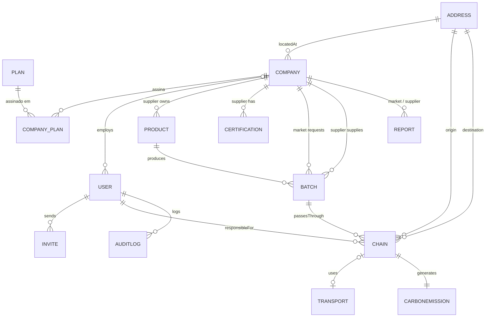

# reference.md — Referência do domínio e da API

> Catálogo técnico complementar ao `spec.md` e ao `plan.md`. Este arquivo concentra detalhes que o agente precisa consultar, mas que não devem ficar nas instruções operacionais do Copilot.

## 1. Entidades

| Entidade | Relações e responsabilidade |
|---|---|
| `Address` | Endereço reutilizado por companhia e etapas |
| `Company` | Companhia (`MARKET` ou `SUPPLIER`) com razão social, CNPJ único, email, telefone, endereço e `maxUsers` (teto de assentos, 10 por padrão; feature 016). Substitui `Supplier` desde a feature 010 |
| `User` | Usuário, email, hash de senha, perfil, companhia e `active`; só o `PLATFORM_ADMIN` não tem companhia. Inativo não entra e não ocupa assento (feature 016) |
| `Invite` | Convite por email (feature 011): quem convidou, email e perfil do convidado, hash SHA-256 do token, `accepted` e `expiresAt` (`createdAt` + 24h, gerado pelo banco). A companhia é a de quem convidou |
| `Certification` | Certificação ambiental de um fornecedor, emissor, validade e status |
| `Product` | Produto de um fornecedor, com categoria, unidade e descrição |
| `Batch` | Lote pedido por um mercado a um fornecedor, com status `PENDING`, `ACTIVE` ou `REJECTED` |
| `Chain` | Etapa do lote, responsável, origem/destino e período |
| `Transport` | Modal, distância, combustível e capacidade da etapa |
| `CarbonEmission` | CO₂ calculado, fator, metodologia e data |
| `Report` | Consolidação por fornecedor, mercado e período |
| `AuditLog` | Evento criado por trigger MySQL, com ator, operação, tabela/ID afetado, snapshots JSON e timestamp; somente leitura pela API |

Os planos e as assinaturas (`plan`, `company_plan`) saíram na feature 016. Os assentos usados (ativos + convites ativos) são calculados pelo `SeatPolicy`, sem coluna própria. As entidades de domínio referenciam objetos relacionados. A infraestrutura resolve essas relações ao reconstruir o domínio a partir das entidades JPA.

## 2. Enums

O domínio possui `CompanyType`, `BatchStatus`, `CertificationStatus`, `ProductCategory`, `ProductUnit`, `StageType`, `TransportMode`, `FuelType`, `CalculationMethod`, `UserRole` e `AuditAction`. Eles representam conjuntos fechados e não devem ser modelados como strings livres. `UserRole.allowedFor(CompanyType)` diz os perfis de cada tipo de companhia (RN-07): `MARKET` aceita `ADMIN`, `MANAGER` e `AUDITOR`; `SUPPLIER` aceita `ADMIN` e `SUPPLIER`; `PLATFORM_ADMIN` não pertence a companhia.

## 3. Casos de uso

```text
company: Register, GetOwn, UpdateOwn
supplier: Get, List, RankBySustainability (catálogo)
certification: Register, UpdateStatus, ListPage with optional status filter
product: Register, Update, List (catálogo do pedido de lote para o mercado)
batch: Register, Reject, GetTraceability, List (filtros supplierId e status)
chain: RegisterStage, ListStagesByBatch
transport: Register
emission: Calculate, GetBatchCarbonFootprint
report: Generate, Get, List
user: Authenticate, UpdateRole, UpdateOwn, List
invite: Send, Get, Accept
audit: ListAuditLogs
dashboard: GetSummary, GetMonthlyEmissions
```

## 4. Rotas

Base path: `/api/v1`. Desde a feature 010, toda leitura é filtrada pela companhia do usuário (RN-12 a RN-14) e toda escrita fora do escopo dele retorna 403 (RN-15). O `PLATFORM_ADMIN` herda as regras de `ADMIN` e vê todas as companhias. Desde a feature 013, qualquer rota pode responder `429` (veja [Segurança](#6-segurança)).

| Recurso | Rotas principais | Acesso e escopo |
|---|---|---|
| Auth | `POST /auth/login` | Público. O email não diferencia maiúscula nem acento. Resposta: `token`, `expiresAt`, `role`, `supplierId`, `companyId`, `companyType`, `companyName` |
| Companies | `POST /companies` (cadastro público de companhia, endereço e `ADMIN`; um `planCode` enviado é ignorado; resposta igual à do login), `GET /companies/me` (com `maxUsers` e `seatsUsed`), `PATCH /companies/me` (razão social, email, telefone e endereço) | Cadastro: público. `GET /me`: usuário com companhia. `PATCH /me`: `ADMIN`. Sem companhia: 403 |
| Users | `GET /users?email={termo}&role={ROLE}&role={ROLE}&active={true\|false}&limit=20&offset=0` (`role` repetido é OU; os filtros se combinam por E; cada item traz `active`), `GET /users/me`, `PATCH /users/me` (próprio nome e senha; `newPassword` exige `currentPassword`), `PATCH /users/{userId}/role`, `PATCH /users/{userId}/status` (`{ "active": boolean }`) | Troca de perfil e de situação: `ADMIN`, só na própria companhia, e `PLATFORM_ADMIN` em qualquer uma. Perfil: o último admin ativo (RN-08) e usuário inativo retornam 409. Situação: desativar a si mesmo, desativar o último `ADMIN` ativo e reativar sem assento livre retornam 409; alvo `PLATFORM_ADMIN` retorna 400; a situação que o usuário já tem retorna 200 sem mudar nada. O inativo perde o acesso na próxima requisição. Listagem: qualquer autenticado, só a própria companhia. Usuários novos só entram por convite |
| Invites | `POST /invites` (`email`, `role`; 201 sem corpo), `GET /invites/{token}` (`email`, `role`, `companyName`, `expiresAt`), `POST /invites/accept` (`token`, `name`, `password`; resposta igual à do login) | Envio: `ADMIN`, na própria companhia; perfil não permitido para o tipo → 400, `PLATFORM_ADMIN` → 403, email já cadastrado (inclusive de usuário inativo, com a orientação de reativá-lo), convite ativo para o email ou companhia sem assento livre (ativos + convites ativos = `maxUsers`) → 409, falha no SendGrid → 502 sem gravar nada. Consulta e aceite: públicos; token desconhecido, expirado ou aceito → 404 "Convite inválido ou expirado." sem dizer qual. O `GET` não consome o token. No aceite, nome ou senha vazios → 400, e companhia sem assento livre ou email já cadastrado → 409 |
| Suppliers | `GET /suppliers`, `GET /suppliers?supplierId={id}`, `GET /suppliers?ranked=true&limit=20&offset=0&search={termo}&workedWith=true`. Cada item traz dados cadastrais, métricas de sustentabilidade, `reportCount` (do mercado logado), `certifications` e `workedWith` | Catálogo global para o mercado (RN-13). Companhia fornecedora: 403, exceto no próprio detalhe |
| Certifications | `GET /certifications?page=0&size=20&status=ACTIVE`, `POST /suppliers/{supplierId}/certifications`, `PATCH /certifications/{certificationId}/status` | Consulta: `AUDITOR`, `MANAGER`, `ADMIN`, `SUPPLIER`; o fornecedor vê só as próprias. Cadastro e status: o fornecedor dono (RN-22) |
| Products | `POST /products`, `PUT /products/{productId}`, `GET /products?limit=20&offset=0&search={termo}&category={c}&unit={u}&supplierId={id}` | Cadastro e edição: o fornecedor dono (RN-16). Listagem: catálogo ordenado para o mercado (feature 015), só os próprios para o fornecedor |
| Batches | `POST /batches` (`productId`, `supplierId`, `quantity`), `PATCH /batches/{batchId}/reject` (`reason`), `GET /batches?page=0&size=20&supplierId={id}&status=PENDING`, `GET /batches/{batchId}/traceability` | Pedido: mercado (`MANAGER`, `ADMIN`); nasce `PENDING`. Recusa: o fornecedor do lote, só em `PENDING` (409 depois). Listagem: os lotes do mercado ou do fornecedor. Rastreabilidade: pública |
| Chains | `POST /batches/{batchId}/stages` (header `X-Responsible-User-Id`), `GET /batches/{batchId}/stages` | Só o mercado ou o fornecedor do lote. Em `PENDING`, só o fornecedor registra `PRODUCTION`, que ativa o lote; em `REJECTED`, 409 |
| Transport | `POST /stages/{chainId}/transport` | Só o mercado ou o fornecedor do lote da etapa |
| Emissions | `POST /stages/{chainId}/emission`, `GET /batches/{batchId}/carbon-footprint` | Cálculo: mercado ou fornecedor do lote. Pegada: pública |
| Reports | `POST /suppliers/{supplierId}/reports`, `GET /reports?limit=20&offset=0&supplierId={id}`, `GET /reports?reportId={id}` | Geração: só mercado, com os lotes dele (RN-23). Leitura: os relatórios do mercado ou os sobre o fornecedor; outro, 403 |
| Audit | `GET /audit-logs?from=2026-09-01&to=2026-09-30&action=UPDATE&userEmail=ana&limit=20&offset=0` (período obrigatório, ação e email opcionais; o email segue a busca textual) | `ADMIN` e `AUDITOR`; só as ações dos usuários da própria companhia (RN-14) |
| Dashboard | `GET /dashboard/summary?limit=10`, `GET /dashboard/emissions?from=2026-01&to=2026-06` | Qualquer autenticado, no escopo da companhia. Mercado: `suppliers` (fornecedores com `workedWith`); fornecedor: `pendingBatches` |

### Rotas e parâmetros removidos na feature 010

| Removido | Substituto |
|---|---|
| `POST /suppliers`, `PUT /suppliers/{id}` | `POST /companies`, pelo próprio fornecedor |
| `PATCH /suppliers/me` | `PATCH /companies/me` (dados da companhia) e `PATCH /users/me` (nome e senha) |
| `supplierId` no corpo de `POST /users` | A companhia vem de quem cria (RN-09) |
| `GET /suppliers?withoutUser=true` | `GET /suppliers?workedWith=true` |
| `GET /suppliers?ranked=true&productId={id}` | `GET /suppliers?ranked=true&category={c}&unit={u}` (RN-21), que também saiu na feature 015 |
| `producedAt` no corpo de `POST /batches` | Preenchido pela etapa `PRODUCTION` (RN-20) |
| `userId` em `SupplierResponseDTO` e `SupplierRankingDTO` | `workedWith` no ranking; o vínculo é `users.company_id` |

### Rotas removidas na feature 011

| Removido | Substituto |
|---|---|
| `POST /users` | `POST /invites` (o `ADMIN` convida) e `POST /invites/accept` (o convidado define nome e senha). O primeiro `ADMIN` continua nascendo no `POST /companies` |

### Rotas e campos removidos na feature 015

| Removido | Substituto |
|---|---|
| `GET /suppliers?ranked=true&category={c}&unit={u}` (recomendação, RN-21 da feature 010) | `GET /products`: o catálogo do mercado já vem ordenado pela RN-02 da feature 015. `category` e `unit` enviados a `/suppliers` são ignorados |
| `co2KgPerUnit` em `SupplierRankingDTO` | `co2KgPerUnit` em cada item de `GET /products` |

### Evento de auditoria

```json
{
  "logId": 981,
  "userId": 7,
  "userEmail": "ana.souza@empresa.com",
  "action": "UPDATE",
  "affectedTable": "company",
  "affectedEntityId": 42,
  "beforeData": { "name": "Fazenda Verde" },
  "afterData": { "name": "Fazenda Verde Ltda" },
  "performedAt": "2026-09-30T14:32:10"
}
```

Para `INSERT`, `beforeData` é `null`; para `DELETE`, `afterData` é `null`. Nos updates, os dois objetos contêm somente valores de colunas que mudaram. FKs são armazenadas como IDs; a trigger omite colunas sensíveis conhecidas e colunas geradas, como os `*_type` das FKs compostas. `STATUS_CHANGE` é usado somente quando um dos campos de estado configurados para a entidade realmente mudou. Veja a [ADR de auditoria no PostgreSQL](../../adr/0001-auditoria-no-postgresql.md) e a [ADR 0002](../../adr/0002-migracao-para-mysql.md) para propagação do ator e detalhe da persistência. A mudança de `batch.status`, como a de `certification.status`, é registrada como `STATUS_CHANGE`.

## 5. DTOs e regras de entrada

- Auth: `LoginRequestDTO`, `LoginResponseDTO`.
- Users: `UserResponseDTO`, `UpdateUserRoleRequestDTO`, `UpdateOwnUserRequestDTO`.
- Invite: `SendInviteRequestDTO`, `InviteDetailsResponseDTO`, `AcceptInviteRequestDTO`; o aceite responde `LoginResponseDTO`.
- Address: `AddressRequestDTO`, `AddressResponseDTO`.
- Company: `RegisterCompanyRequestDTO`, `UpdateOwnCompanyRequestDTO`, `CompanyResponseDTO`.
- Plan: `PlanResponseDTO`.
- Supplier: `SupplierResponseDTO`, `SupplierRankingDTO`.
- Certification: `CertificationRequestDTO`, `CertificationResponseDTO`, `UpdateCertificationStatusRequestDTO`.
- Product: `ProductRequestDTO`, `ProductResponseDTO`.
- Batch: `BatchRequestDTO`, `RejectBatchRequestDTO`, `BatchResponseDTO` (com `status`, `rejectionReason`, `marketId` e `marketName`), `BatchTraceabilityResponseDTO`.
- Chain: `ChainRequestDTO`, `ChainResponseDTO`.
- Transport: `TransportRequestDTO`, `TransportResponseDTO`.
- Emission: `CarbonEmissionRequestDTO`, `CarbonEmissionResponseDTO`, `CarbonFootprintResponseDTO`.
- Paginação por deslocamento: as rotas de usuários, ranking de fornecedores (`GET /suppliers?ranked=true`), produtos, relatórios e auditoria retornam `OffsetPageResponseDTO<T>`, com `items`, `limit`, `offset`, `hasNext` e `totalPages`. A fábrica do DTO deriva `hasNext` e `totalPages` da contagem filtrada total e dos parâmetros recebidos.
- Users: `UserResponseDTO` representa cada usuário; o filtro `email` segue a busca textual. Limite padrão 20, máximo 100; offset padrão 0.
- Report: `ReportRequestDTO`, `ReportResponseDTO`, `ReportListItemDTO` e `ReportDetailDTO`. A listagem retorna CNPJ e nome do fornecedor, total de lotes produzidos entre as datas do relatório e CO₂ total; o total considera o filtro de fornecedor e a autorização aplicada. O detalhe também mantém `trackedProductCount`. Limite padrão 20, máximo 100; offset padrão 0.
- Audit: `AuditLogResponseDTO` representa eventos persistidos pelas triggers, incluindo `affectedEntityId`, `beforeData` e `afterData`; a contagem considera intervalo, ação e email do usuário. A API não persiste eventos de auditoria.

As demais respostas offset-paginadas de produtos e ranking de fornecedores também contêm `items`, `limit`, `offset`, `hasNext` e `totalPages`. O total de páginas é calculado sobre todos os resultados após a aplicação dos filtros e é `0` quando a consulta não retorna registros.
- Dashboard: `DashboardSummaryResponseDTO`, `RecentBatchSummaryDTO`.

Dashboard aceita `limit` entre `1` e `100` para a lista de lotes recentes; omitido ou nulo usa `10`. A contagem de lotes ativos exige ao menos uma etapa e exclui os lotes cuja etapa mais recente seja `RETAIL`. A última etapa é definida por `startedAt` e, em caso de empate, pelo maior `chainId`. Lotes sem etapas também não aparecem na lista recente, pois não possuem `status`; lotes em `RETAIL` podem aparecer como recentes. As certificações consideradas vencem de hoje até os próximos 30 dias, inclusive. Para o mercado, `suppliers` conta os fornecedores com quem ele tem ou teve lote e `pendingBatches` vem nulo; para a companhia fornecedora, `pendingBatches` conta os lotes `PENDING` dela e `suppliers` vem nulo; o `PLATFORM_ADMIN` recebe `suppliers` com todos os fornecedores. A emissão mensal soma `co2Kg` por `calculatedAt` dentro do mês calendário corrente e retorna zero quando não há registros.

Na listagem e consulta individual de relatórios, a companhia fornecedora tem o `supplierId` limitado ao dela, e o filtro de fornecedor que ela enviar é ignorado; o mercado vê só os relatórios com o `market_id` dele. A consulta individual usa `GET /reports?reportId={id}` e retorna 403 para relatório de outra companhia. A antiga rota aninhada `GET /suppliers/{supplierId}/reports` foi removida; use `GET /reports?supplierId={id}`.

As consultas de fornecedores usam `GET /suppliers`: sem parâmetros retorna a lista; `supplierId` retorna o detalhe; `ranked=true` retorna o ranking paginado e aceita `limit`, `offset` e `search`. A lista e os itens do ranking usam a mesma estrutura com `supplierId`, `name`, `cnpj`, `address`, `phone`, `registeredAt`, `workedWith`, `sustainabilityScore`, `activeCertificationCount` e `totalCo2Kg`. `supplierId` e `ranked` não podem ser enviados juntos, mesmo com `ranked=false`.

`GET /products` é o catálogo do pedido de lote (feature 015). Para o mercado e o `PLATFORM_ADMIN`, lista os produtos de todos os fornecedores, e cada item traz, além de `productId`, `supplierId`, `name`, `category`, `unit` e `description`:

- `supplierName`;
- `acceptedBatchesLast30Days`: lotes `ACTIVE` do produto pedidos pelo mercado logado nos últimos 30 dias, pelo `created_at` do lote, porque a data do aceite não é gravada. Para o `PLATFORM_ADMIN`, conta os de todos os mercados;
- `co2KgPerUnit`: CO₂ médio por unidade do fornecedor na categoria e unidade do produto, ponderado pela quantidade dos lotes, com 4 casas. Vem `null` sem histórico.

A ordem é `acceptedBatchesLast30Days` decrescente, `co2KgPerUnit` crescente com `null` no fim, `name` e `productId`. Ela substitui a recomendação de fornecedores por categoria e unidade (RN-21 da feature 010), que comparava pelo mesmo `co2KgPerUnit`. `category` e `unit` são filtros opcionais e independentes, e `supplierId` filtra por fornecedor. Para a companhia fornecedora nada muda: só os produtos dela, por `productId`, com os três campos `null`.

### Busca textual

Os parâmetros `search` de produtos e do ranking de fornecedores, `email` de usuários e `userEmail` de auditoria usam só índices FULLTEXT do MySQL, sem `LIKE` (feature 014):

- Cada palavra digitada casa pelo **início** de uma palavra indexada: "ara" acha "Arábica", e "rábica" não. As palavras são obrigatórias, com uma exceção: ao lado de outra palavra, uma palavra que o índice não guarda inteira (menos de 3 letras ou stopword do InnoDB, como "de" e "com") vira opcional. "c" sozinho já filtra, e "café de montanha" acha "Café Bourbon Amarelo de Montanha".
- Acento e maiúscula não importam: `product.name`, `product.description`, `company.name` e `users.email` usam `utf8mb4_0900_ai_ci`.
- Produtos casam nome e descrição, além do nome ou rótulo exato de uma categoria. No catálogo do mercado, casam também o nome do fornecedor, com cada lado avaliado inteiro: "café serra" não acha o café do fornecedor "Grãos da Serra". Fornecedores casam o nome, ou o **início** do CNPJ pelos dígitos, com ou sem máscara: "12.345" e "12345" acham `12345678000195`, e um trecho do meio não acha.
- O email é quebrado em palavras por `.`, `@` e `-`, e o `_` faz parte da palavra: "kane", "bayern" e "h.kane@bayern.com" acham `h.kane@bayern.com`; "silva" não acha `joao_silva@x.com`, e "joao_s" acha.
- Um termo sem letras nem dígitos (ex.: "--") vale como busca vazia e lista tudo.
- Limite: o índice não guarda palavras de 1 e 2 letras nem stopwords dos dados, então "SP" sozinho não acha a palavra "SP" (acha "Spirulina"). A melhoria está no plan da feature 014, §6.

Como o email usa `ai_ci`, o login e o `UNIQUE` de `users.email` também ignoram maiúscula e acento: `H.Kane@Bayern.com` entra na conta de `h.kane@bayern.com`, e não dá para cadastrar os dois.

O `userId` de auditoria vem do contexto autenticado, nunca do corpo da requisição. O responsável da etapa vem do header `X-Responsible-User-Id` e precisa ser do mercado ou do fornecedor do lote. Para cada transação de escrita, a API define `@app_user_id` na conexão antes da primeira mutação e o limpa ao fim; a trigger usa o valor para atribuir o ator. `emissionFactor` e `co2Kg` são calculados pelo backend, nunca aceitos do cliente.

## 6. Segurança

- JWT stateless com claims `userId`, `email`, `role`, `companyId`, `companyType` e `supplierId` (igual a `companyId` quando a companhia é fornecedora). Um token sem `companyId` só autentica para o `PLATFORM_ADMIN`.
- `RoleHierarchy` com `ROLE_PLATFORM_ADMIN > ROLE_ADMIN`, nas rotas e nos `@PreAuthorize`.
- Senhas armazenadas somente como hash BCrypt.
- `JWT_SECRET` é obrigatório, sem valor padrão (a API não sobe sem ele), e deve ter pelo menos 256 bits.
- Rotas públicas: login, `POST /companies`, `GET /invites/{token}`, `POST /invites/accept`, rastreabilidade e pegada de carbono.
- Token de convite: 32 bytes de `SecureRandom` em base64url no link `<APP_FRONTEND_URL>/convites/<token>`; o banco guarda só o SHA-256. Vale 24h e uma vez. Veja a [ADR 0004](../../adr/0004-token-de-convite-opaco-com-hash.md).
- Rate limit (feature 013), em memória e com janela fixa de 1 minuto:
  - **Global:** 120 requisições por minuto em todas as rotas, contadas por `userId` quando há JWT válido e por IP quando não há.
  - **Estrito por IP**, somado ao global: `POST /auth/login` 5, `POST /invites/accept` 5, `GET /invites/{token}` 10 e `POST /companies` 3.
  - **Bloqueio:** passou do limite, a resposta é `429` com `Retry-After` (segundos até o fim da janela) e `{ "message": "Muitas requisições. Tente novamente em instantes." }`.
  - **IP:** é o do `X-Forwarded-For` gravado pelo Caddy, que descarta o header vindo do cliente.
  - **Limites:** os contadores zeram num restart e valem para uma instância só. Desligado na configuração de testes (`rate-limit.enabled=false`).
  - Detalhes em [`docs/features/013-rate-limit`](../013-rate-limit/spec.md).
- Risco conhecido: `POST /companies` é público e não tem confirmação de email nem captcha. O rate limit (3 por minuto por IP) reduz o cadastro em massa, mas não impede o que vem de muitos IPs.
- Risco conhecido: `batchId` sequencial exposto publicamente pode permitir enumeração. O limite global (120 por minuto por IP) torna a enumeração lenta, mas não a impede; um UUID público resolveria.

## 7. Variáveis de ambiente

| Variável | Finalidade |
|---|---|
| `SPRING_PROFILES_ACTIVE` | Perfil ativo |
| `SERVER_PORT` | Porta HTTP |
| `SPRING_DATASOURCE_URL` | URL JDBC |
| `SPRING_DATASOURCE_USERNAME` | Usuário MySQL da API |
| `MYSQL_APP_PASSWORD` | Senha MySQL da API (`supply_app`). Também é lida pelo init do MySQL |
| `MYSQL_ROOT_PASSWORD` | Senha do `root` do MySQL, usada pelo Flyway e pelo init |
| `JWT_SECRET` | Chave de assinatura JWT; obrigatória, sem padrão |
| `JWT_EXPIRATION_MS` | Expiração do token |
| `CORS_ALLOWED_ORIGINS` | Origens permitidas |
| `FLYWAY_ENABLED` | Ativação do Flyway |
| `SENDGRID_API_KEY` | Chave da API do Twilio SendGrid (permissão Mail Send). Obrigatória: a API não sobe sem ela |
| `SENDGRID_FROM` | Remetente dos emails, verificado no SendGrid. Obrigatória |
| `SITE_ADDRESS` | Domínio público, servido pelo Caddy. Sem `APP_FRONTEND_URL`, o link do convite usa `https://<SITE_ADDRESS>` |
| `APP_FRONTEND_URL` | URL do front usada no link do convite (ex.: `http://localhost:4200`), nunca o `Host` da requisição. Opcional: sem ela, vale `https://<SITE_ADDRESS>` |

Segredos não devem ter valores reais, previsíveis ou versionados. Eles ficam no `.env` da raiz, que não é versionado e é lido pelo compose e pelo `spring-boot:run` (feature 012).

## 8. Modelo de dados



O tipo da companhia em cada vínculo e a assinatura ativa única são garantidos pelo banco; veja a [ADR 0003](../../adr/0003-tipo-de-companhia-por-fk-composta.md).

## Paginação das listagens

As listagens gerais de lotes e certificações aceitam `page` (índice iniciado em 0) e `size` (padrão 20, máximo 100). A API limita a quantidade retornada por chamada para evitar respostas excessivamente grandes.
