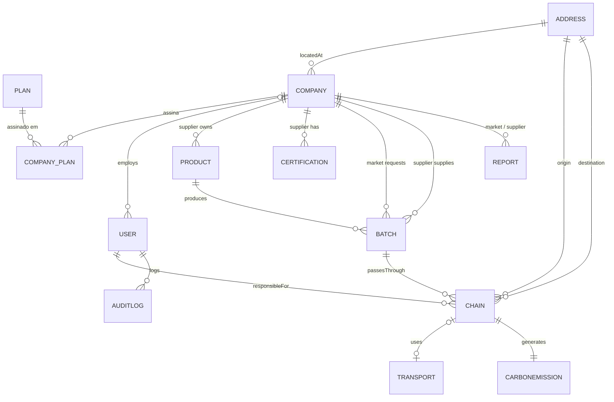

# reference.md — Referência do domínio e da API

> Catálogo técnico complementar ao `spec.md` e ao `plan.md`. Este arquivo concentra detalhes que o agente precisa consultar, mas que não devem ficar nas instruções operacionais do Copilot.

## 1. Entidades

| Entidade | Relações e responsabilidade |
|---|---|
| `Address` | Endereço reutilizado por companhia e etapas |
| `Company` | Companhia (`MARKET` ou `SUPPLIER`) com razão social, CNPJ único, email, telefone e endereço. Substitui `Supplier` desde a feature 010 |
| `Plan` | Catálogo de planos (`BASIC`, `PRO`, `PRO_MAX`) com o limite de usuários (`maxUsers`) |
| `User` | Usuário, email, hash de senha, perfil e companhia; só o `PLATFORM_ADMIN` não tem companhia |
| `Certification` | Certificação ambiental de um fornecedor, emissor, validade e status |
| `Product` | Produto de um fornecedor, com categoria, unidade e descrição |
| `Batch` | Lote pedido por um mercado a um fornecedor, com status `PENDING`, `ACTIVE` ou `REJECTED` |
| `Chain` | Etapa do lote, responsável, origem/destino e período |
| `Transport` | Modal, distância, combustível e capacidade da etapa |
| `CarbonEmission` | CO₂ calculado, fator, metodologia e data |
| `Report` | Consolidação por fornecedor, mercado e período |
| `AuditLog` | Evento criado por trigger MySQL, com ator, operação, tabela/ID afetado, snapshots JSON e timestamp; somente leitura pela API |

A assinatura (`company_plan`) não tem entidade de domínio: `CompanyRepository.subscribe` abre a assinatura ativa e `PlanRepository.findActiveByCompanyId` lê o plano dela. As entidades de domínio referenciam objetos relacionados. A infraestrutura resolve essas relações ao reconstruir o domínio a partir das entidades JPA.

## 2. Enums

O domínio possui `CompanyType`, `BatchStatus`, `CertificationStatus`, `ProductCategory`, `ProductUnit`, `StageType`, `TransportMode`, `FuelType`, `CalculationMethod`, `UserRole` e `AuditAction`. Eles representam conjuntos fechados e não devem ser modelados como strings livres. `UserRole.allowedFor(CompanyType)` diz os perfis de cada tipo de companhia (RN-07): `MARKET` aceita `ADMIN`, `MANAGER` e `AUDITOR`; `SUPPLIER` aceita `ADMIN` e `SUPPLIER`; `PLATFORM_ADMIN` não pertence a companhia.

## 3. Casos de uso

```text
company: Register, GetOwn, UpdateOwn
plan: List
supplier: Get, List, RankBySustainability (catálogo; recomendação por category + unit)
certification: Register, UpdateStatus, ListPage with optional status filter
product: Register, Update, List
batch: Register, Reject, GetTraceability, List (filtros supplierId e status)
chain: RegisterStage, ListStagesByBatch
transport: Register
emission: Calculate, GetBatchCarbonFootprint
report: Generate, Get, List
user: Register, Authenticate, UpdateRole, UpdateOwn, List
audit: ListAuditLogs
dashboard: GetSummary, GetMonthlyEmissions
```

## 4. Rotas

Base path: `/api/v1`. Desde a feature 010, toda leitura é filtrada pela companhia do usuário (RN-12 a RN-14) e toda escrita fora do escopo dele retorna 403 (RN-15). O `PLATFORM_ADMIN` herda as regras de `ADMIN` e vê todas as companhias.

| Recurso | Rotas principais | Acesso e escopo |
|---|---|---|
| Auth | `POST /auth/login` | Público. Resposta: `token`, `expiresAt`, `role`, `supplierId`, `companyId`, `companyType`, `companyName` |
| Plans | `GET /plans` | Público. Catálogo com `code`, `name` e `maxUsers` |
| Companies | `POST /companies` (cadastro público de companhia, endereço, assinatura e `ADMIN`; resposta igual à do login), `GET /companies/me`, `PATCH /companies/me` (razão social, email, telefone e endereço) | Cadastro: público. `GET /me`: usuário com companhia. `PATCH /me`: `ADMIN`. Sem companhia: 403 |
| Users | `POST /users`, `GET /users?email={fragment}&limit=20&offset=0`, `GET /users/me`, `PATCH /users/me` (próprio nome e senha; `newPassword` exige `currentPassword`), `PATCH /users/{userId}/role` | Criação e troca de perfil: `ADMIN`, só na própria companhia. Listagem: qualquer autenticado, só a própria companhia. O limite do plano (RN-04) e o último admin (RN-08) retornam 409 |
| Suppliers | `GET /suppliers`, `GET /suppliers?supplierId={id}`, `GET /suppliers?ranked=true&limit=20&offset=0&search={termo}&workedWith=true`, recomendação com `ranked=true&category={c}&unit={u}`. Cada item traz dados cadastrais, métricas de sustentabilidade, `reportCount` (do mercado logado), `certifications` e `workedWith` | Catálogo global para o mercado (RN-13). Companhia fornecedora: 403, exceto no próprio detalhe |
| Certifications | `GET /certifications?page=0&size=20&status=ACTIVE`, `POST /suppliers/{supplierId}/certifications`, `PATCH /certifications/{certificationId}/status` | Consulta: `AUDITOR`, `MANAGER`, `ADMIN`, `SUPPLIER`; o fornecedor vê só as próprias. Cadastro e status: o fornecedor dono (RN-22) |
| Products | `POST /products`, `PUT /products/{productId}`, `GET /products?limit=20&offset=0&search={termo}&supplierId={id}` | Cadastro e edição: o fornecedor dono (RN-16). Listagem: catálogo para o mercado, só os próprios para o fornecedor |
| Batches | `POST /batches` (`productId`, `supplierId`, `quantity`), `PATCH /batches/{batchId}/reject` (`reason`), `GET /batches?page=0&size=20&supplierId={id}&status=PENDING`, `GET /batches/{batchId}/traceability` | Pedido: mercado (`MANAGER`, `ADMIN`); nasce `PENDING`. Recusa: o fornecedor do lote, só em `PENDING` (409 depois). Listagem: os lotes do mercado ou do fornecedor. Rastreabilidade: pública |
| Chains | `POST /batches/{batchId}/stages` (header `X-Responsible-User-Id`), `GET /batches/{batchId}/stages` | Só o mercado ou o fornecedor do lote. Em `PENDING`, só o fornecedor registra `PRODUCTION`, que ativa o lote; em `REJECTED`, 409 |
| Transport | `POST /stages/{chainId}/transport` | Só o mercado ou o fornecedor do lote da etapa |
| Emissions | `POST /stages/{chainId}/emission`, `GET /batches/{batchId}/carbon-footprint` | Cálculo: mercado ou fornecedor do lote. Pegada: pública |
| Reports | `POST /suppliers/{supplierId}/reports`, `GET /reports?limit=20&offset=0&supplierId={id}`, `GET /reports?reportId={id}` | Geração: só mercado, com os lotes dele (RN-23). Leitura: os relatórios do mercado ou os sobre o fornecedor; outro, 403 |
| Audit | `GET /audit-logs?from=2026-09-01&to=2026-09-30&action=UPDATE&userEmail=ana&limit=20&offset=0` (período obrigatório, ação e email opcionais) | `ADMIN` e `AUDITOR`; só as ações dos usuários da própria companhia (RN-14) |
| Dashboard | `GET /dashboard/summary?limit=10`, `GET /dashboard/emissions?from=2026-01&to=2026-06` | Qualquer autenticado, no escopo da companhia. Mercado: `suppliers` (fornecedores com `workedWith`); fornecedor: `pendingBatches` |

### Rotas e parâmetros removidos na feature 010

| Removido | Substituto |
|---|---|
| `POST /suppliers`, `PUT /suppliers/{id}` | `POST /companies`, pelo próprio fornecedor |
| `PATCH /suppliers/me` | `PATCH /companies/me` (dados da companhia) e `PATCH /users/me` (nome e senha) |
| `supplierId` no corpo de `POST /users` | A companhia vem de quem cria (RN-09) |
| `GET /suppliers?withoutUser=true` | `GET /suppliers?workedWith=true` |
| `GET /suppliers?ranked=true&productId={id}` | `GET /suppliers?ranked=true&category={c}&unit={u}` (RN-21) |
| `producedAt` no corpo de `POST /batches` | Preenchido pela etapa `PRODUCTION` (RN-20) |
| `userId` em `SupplierResponseDTO` e `SupplierRankingDTO` | `workedWith` no ranking; o vínculo é `users.company_id` |

### Evento de auditoria

```json
{
  "logId": 981,
  "userId": 7,
  "userEmail": "ana.souza@empresa.com",
  "action": "UPDATE",
  "affectedTable": "company",
  "affectedEntityId": 42,
  "beforeData": { "name": "Fazenda Verde" },
  "afterData": { "name": "Fazenda Verde Ltda" },
  "performedAt": "2026-09-30T14:32:10"
}
```

Para `INSERT`, `beforeData` é `null`; para `DELETE`, `afterData` é `null`. Nos updates, os dois objetos contêm somente valores de colunas que mudaram. FKs são armazenadas como IDs; a trigger omite colunas sensíveis conhecidas e colunas geradas, como os `*_type` das FKs compostas e `company_plan.active_company_id`. `STATUS_CHANGE` é usado somente quando um dos campos de estado configurados para a entidade realmente mudou. Veja a [ADR de auditoria no PostgreSQL](../../adr/0001-auditoria-no-postgresql.md) e a [ADR 0002](../../adr/0002-migracao-para-mysql.md) para propagação do ator e detalhe da persistência. A mudança de `batch.status`, como a de `certification.status`, é registrada como `STATUS_CHANGE`.

## 5. DTOs e regras de entrada

- Auth: `LoginRequestDTO`, `LoginResponseDTO`.
- Users: `UserRequestDTO`, `UserResponseDTO`, `UpdateUserRoleRequestDTO`.
- Address: `AddressRequestDTO`, `AddressResponseDTO`.
- Company: `RegisterCompanyRequestDTO`, `UpdateOwnCompanyRequestDTO`, `CompanyResponseDTO`.
- Plan: `PlanResponseDTO`.
- Supplier: `SupplierResponseDTO`, `SupplierRankingDTO`.
- Certification: `CertificationRequestDTO`, `CertificationResponseDTO`, `UpdateCertificationStatusRequestDTO`.
- Product: `ProductRequestDTO`, `ProductResponseDTO`.
- Batch: `BatchRequestDTO`, `RejectBatchRequestDTO`, `BatchResponseDTO` (com `status`, `rejectionReason`, `marketId` e `marketName`), `BatchTraceabilityResponseDTO`.
- Chain: `ChainRequestDTO`, `ChainResponseDTO`.
- Transport: `TransportRequestDTO`, `TransportResponseDTO`.
- Emission: `CarbonEmissionRequestDTO`, `CarbonEmissionResponseDTO`, `CarbonFootprintResponseDTO`.
- Paginação por deslocamento: as rotas de usuários, ranking de fornecedores (`GET /suppliers?ranked=true`), produtos, relatórios e auditoria retornam `OffsetPageResponseDTO<T>`, com `items`, `limit`, `offset`, `hasNext` e `totalPages`. A fábrica do DTO deriva `hasNext` e `totalPages` da contagem filtrada total e dos parâmetros recebidos.
- Users: `UserResponseDTO` representa cada usuário; a busca `email` parcial case-insensitive usa o índice GIN trigram `lower(email)`. Limite padrão 20, máximo 100; offset padrão 0.
- Report: `ReportRequestDTO`, `ReportResponseDTO`, `ReportListItemDTO` e `ReportDetailDTO`. A listagem retorna CNPJ e nome do fornecedor, total de lotes produzidos entre as datas do relatório e CO₂ total; o total considera o filtro de fornecedor e a autorização aplicada. O detalhe também mantém `trackedProductCount`. Limite padrão 20, máximo 100; offset padrão 0.
- Audit: `AuditLogResponseDTO` representa eventos persistidos pelas triggers, incluindo `affectedEntityId`, `beforeData` e `afterData`; a contagem considera intervalo, ação e email do usuário. A API não persiste eventos de auditoria.

As demais respostas offset-paginadas de produtos e ranking de fornecedores também contêm `items`, `limit`, `offset`, `hasNext` e `totalPages`. O total de páginas é calculado sobre todos os resultados após a aplicação dos filtros e é `0` quando a consulta não retorna registros.
- Dashboard: `DashboardSummaryResponseDTO`, `RecentBatchSummaryDTO`.

Dashboard aceita `limit` entre `1` e `100` para a lista de lotes recentes; omitido ou nulo usa `10`. A contagem de lotes ativos exige ao menos uma etapa e exclui os lotes cuja etapa mais recente seja `RETAIL`. A última etapa é definida por `startedAt` e, em caso de empate, pelo maior `chainId`. Lotes sem etapas também não aparecem na lista recente, pois não possuem `status`; lotes em `RETAIL` podem aparecer como recentes. As certificações consideradas vencem de hoje até os próximos 30 dias, inclusive. Para o mercado, `suppliers` conta os fornecedores com quem ele tem ou teve lote e `pendingBatches` vem nulo; para a companhia fornecedora, `pendingBatches` conta os lotes `PENDING` dela e `suppliers` vem nulo; o `PLATFORM_ADMIN` recebe `suppliers` com todos os fornecedores. A emissão mensal soma `co2Kg` por `calculatedAt` dentro do mês calendário corrente e retorna zero quando não há registros.

Na listagem e consulta individual de relatórios, a companhia fornecedora tem o `supplierId` limitado ao dela, e o filtro de fornecedor que ela enviar é ignorado; o mercado vê só os relatórios com o `market_id` dele. A consulta individual usa `GET /reports?reportId={id}` e retorna 403 para relatório de outra companhia. A antiga rota aninhada `GET /suppliers/{supplierId}/reports` foi removida; use `GET /reports?supplierId={id}`.

As consultas de fornecedores usam `GET /suppliers`: sem parâmetros retorna a lista; `supplierId` retorna o detalhe; `ranked=true` retorna o ranking paginado e aceita `limit`, `offset` e `search`. A lista e os itens do ranking usam a mesma estrutura com `supplierId`, `name`, `cnpj`, `address`, `phone`, `registeredAt`, `workedWith`, `sustainabilityScore`, `activeCertificationCount` e `totalCo2Kg`. `supplierId` e `ranked` não podem ser enviados juntos, mesmo com `ranked=false`.

O `userId` de auditoria vem do contexto autenticado, nunca do corpo da requisição. O responsável da etapa vem do header `X-Responsible-User-Id` e precisa ser do mercado ou do fornecedor do lote. Para cada transação de escrita, a API define `@app_user_id` na conexão antes da primeira mutação e o limpa ao fim; a trigger usa o valor para atribuir o ator. `emissionFactor` e `co2Kg` são calculados pelo backend, nunca aceitos do cliente.

## 6. Segurança

- JWT stateless com claims `userId`, `email`, `role`, `companyId`, `companyType` e `supplierId` (igual a `companyId` quando a companhia é fornecedora). Um token sem `companyId` só autentica para o `PLATFORM_ADMIN`.
- `RoleHierarchy` com `ROLE_PLATFORM_ADMIN > ROLE_ADMIN`, nas rotas e nos `@PreAuthorize`.
- Senhas armazenadas somente como hash BCrypt.
- `JWT_SECRET` deve ser fornecido externamente e ter pelo menos 256 bits.
- Rotas públicas: login, `GET /plans`, `POST /companies`, rastreabilidade e pegada de carbono.
- Risco conhecido: `POST /companies` é público e não tem confirmação de email, captcha nem rate limit (fora de escopo da feature 010).
- Risco conhecido: `batchId` sequencial exposto publicamente pode permitir enumeração; avaliar rate limiting ou UUID público.

## 7. Variáveis de ambiente

| Variável | Finalidade |
|---|---|
| `SPRING_PROFILES_ACTIVE` | Perfil ativo |
| `SERVER_PORT` | Porta HTTP |
| `SPRING_DATASOURCE_URL` | URL JDBC |
| `SPRING_DATASOURCE_USERNAME` | Usuário MySQL da API |
| `SPRING_DATASOURCE_PASSWORD` | Senha MySQL da API |
| `JWT_SECRET` | Chave de assinatura JWT |
| `JWT_EXPIRATION_MS` | Expiração do token |
| `CORS_ALLOWED_ORIGINS` | Origens permitidas |
| `FLYWAY_ENABLED` | Ativação do Flyway |

Segredos não devem ter valores reais, previsíveis ou versionados.

## 8. Modelo de dados



O tipo da companhia em cada vínculo e a assinatura ativa única são garantidos pelo banco; veja a [ADR 0003](../../adr/0003-tipo-de-companhia-por-fk-composta.md).

## Paginação das listagens

As listagens gerais de lotes e certificações aceitam `page` (índice iniciado em 0) e `size` (padrão 20, máximo 100). A API limita a quantidade retornada por chamada para evitar respostas excessivamente grandes.
