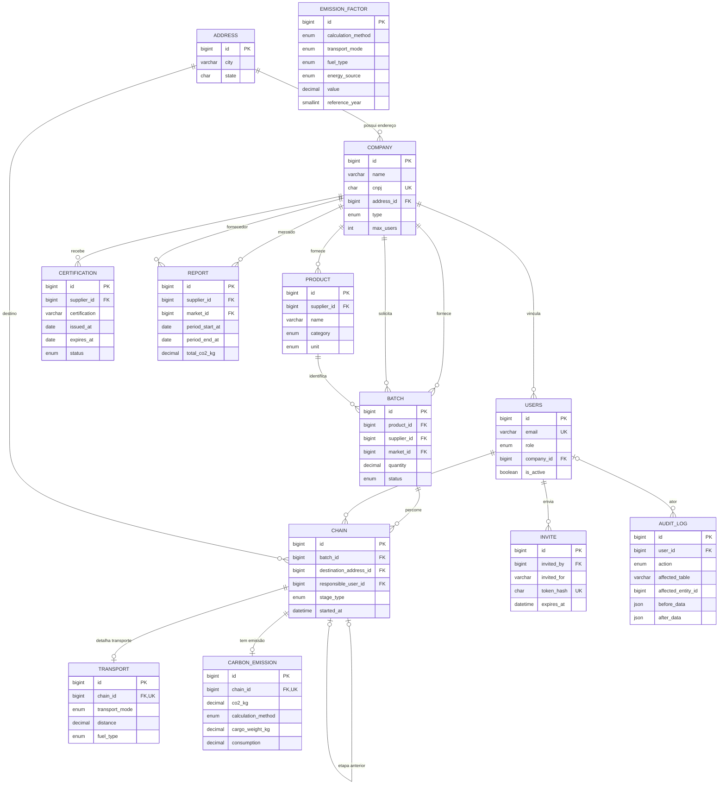

# SQL da entrega

Esta pasta reúne scripts legíveis do schema MySQL 8.4, consultas usadas pela API e consultas de demonstração. As migrations em `src/main/resources/db/migration` continuam sendo a fonte de verdade e a única forma suportada de evoluir o banco; os arquivos daqui são uma visão organizada do estado atual, não migrations.

## Estrutura

- `entities/`: um `CREATE TABLE` por arquivo, incluindo chaves e índices.
- `views/`: uma definição de view por arquivo.
- `procedures/`: uma procedure por arquivo, incluindo as rotinas auxiliares de auditoria.
- `functions/`: funções armazenadas.
- `triggers/`: um arquivo por trigger de auditoria.
- `events/`: eventos agendados do MySQL.
- `queries/api/`: um arquivo por consulta SQL nativa escrita explicitamente pela API, com o nome do repositório e método de origem.
- `queries/reports/`: consultas SELECT independentes para demonstrar relatórios e views.

Os índices pertencem à definição da tabela no MySQL e estão declarados dentro de cada `CREATE TABLE`, mesmo quando foram adicionados por migrations posteriores. Por isso não há uma pasta separada de índices.

Para criar as tabelas manualmente, respeite as FKs nesta ordem: `address`, `company`, `users`, `product`, `certification`, `batch`, `chain`, `transport`, `carbon_emission`, `report`, `audit_log`, `invite`, `emission_factor`. Os arquivos de procedures, functions e triggers usam `DELIMITER`; crie a conta `supply_audit` antes dos triggers que têm esse `DEFINER`. Para uma restauração completa, prefira `scripts/gerar-sql-entrega.sh`, que também exporta os grants.

Os arquivos de `queries/api/` preservam parâmetros nomeados como `:supplierId`; são documentação das consultas Spring Data e não podem ser executados diretamente no cliente `mysql` sem substituir esses parâmetros. O SQL gerado automaticamente pelo Hibernate e as consultas derivadas dos nomes de métodos não são duplicados aqui; consulte as classes Java correspondentes.

## Decisões das entidades

| Tabela | Finalidade e decisão de modelagem |
|---|---|
| `address` | Endereço reutilizado por companhias e destinos de etapas; evita repetir os campos de endereço. |
| `company` | Representa mercado e fornecedor numa entidade comum, diferenciados por `type`; substituiu a tabela `supplier`. |
| `users` | Contas e papéis de acesso. `company_id` pode ser nulo apenas para `PLATFORM_ADMIN`; `is_active` permite desativar conta sem apagar histórico. |
| `product` | Catálogo pertencente a um fornecedor. A FK composta com `supplier_type` garante que o vínculo seja com uma companhia do tipo fornecedor. |
| `certification` | Certificações de fornecedores, com validade e estado; a FK composta impede associá-las a mercados. |
| `batch` | Lote solicitado por um mercado a um fornecedor, associado ao produto e ao estado do ciclo de vida. FKs compostas preservam os tipos de companhia e a correspondência produto-fornecedor. |
| `chain` | Etapas ordenadas de cada lote. `previous_stage_type` é gerada e usada com FK composta para impor a sequência; a origem é derivada do destino da etapa anterior. |
| `transport` | Dados do modal, distância, combustível e capacidade para uma etapa de transporte; relação 1:1 com `chain`. |
| `carbon_emission` | Emissão calculada por etapa, com método, fator e dados de atividade; relação 1:1 com `chain`. |
| `emission_factor` | Fatores versionados por método e atividade para reproduzir os cálculos; a API tem somente leitura nessa tabela. |
| `report` | Retrato persistido de emissões e contagens para um período, por mercado e fornecedor. |
| `audit_log` | Histórico de alterações com snapshots JSON; triggers registram operações e o usuário associado pode ser nulo para ações sem ator autenticado. |
| `invite` | Convites de usuários. Guarda hash do token, não o token; `expires_at` é gerada a partir de `created_at`. |

`plan`, `company_plan` e `supplier` não fazem parte do schema atual: foram removidas por migrations.

## Diagrama entidade-relacionamento (DER)

## Atualização

Ao alterar o schema, crie a migration Flyway primeiro e atualize os arquivos desta pasta para refletir o schema resultante. Para a exportação completa a partir de um banco migrado, use `scripts/gerar-sql-entrega.sh`.
